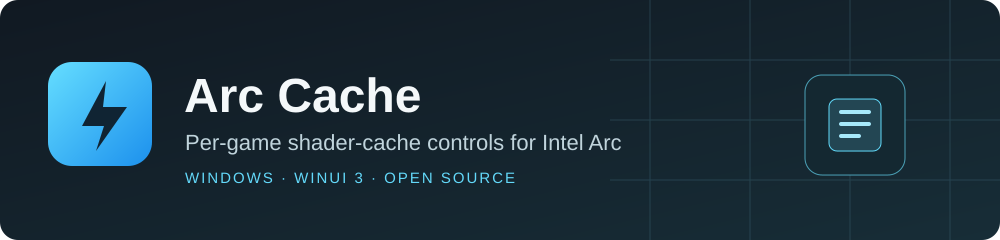

<p align="center">
  
</p>

<p align="center">
  <a href="https://github.com/nyannoying1337/ArcCache/releases"></a>
  
  
  <a href="LICENSE"></a>
</p>

<p align="center">
  <strong>Choose a cache-limit preset for a game without replacing your installed Intel driver.</strong><br />
  A native Windows app with Steam discovery, verified private copies and recovery controls.
</p>

<p align="center">
  <a href="https://github.com/nyannoying1337/ArcCache/releases"><strong>Downloads</strong></a> ·
  <a href="src/ArcCache.WinUI/docs/QUICKSTART.md"><strong>Getting started</strong></a> ·
  <a href="src"><strong>Browse source</strong></a> ·
  <a href="docs/DEVELOPMENT.md"><strong>Build it yourself</strong></a> ·
  <a href="https://github.com/nyannoying1337/ArcCache/issues"><strong>Report a problem</strong></a>
</p>

## Pick your version

| | Standard preview | Large-cache experimental preview |
| --- | --- | --- |
| Download | [Standard release](https://github.com/nyannoying1337/ArcCache/releases/tag/arc-cache-standard-preview-2026.10.13) | [Experimental release](https://github.com/nyannoying1337/ArcCache/releases/tag/arc-cache-experimental-xe3-preview-2026.10.13) |
| Presets | Original 512 MiB · 1 · 2 · 4 GiB | Standard presets + 8 · 16 GiB |
| Source | [`main`](https://github.com/nyannoying1337/ArcCache/tree/main/src) | [`large-cache-experimental`](https://github.com/nyannoying1337/ArcCache/tree/large-cache-experimental/src) |
| Start here if… | You want the standard workflow | You want larger-limit experiments, DLL scans and Xe3 device tests |

**Currently supported:** the exact qualified **Intel Arc B580 / Xe2 driver 32.0.101.9034** package. Unknown packages stay blocked. Xe3 game profiles are not qualified; the experimental build offers isolated Xe3 device tests.

> **These are unsigned previews.** Loading tests do not prove effective shader-cache capacity. 8/16 GiB gameplay and large-cache reload remain unverified; a large cache can require roughly its size in contiguous RAM. [Test coverage and compatibility](docs/TESTING.md).

**You are browsing the experimental branch.** Use `main` for the standard source.

## Get started

1. **Download and extract the entire ZIP.** Open `ArcCache.exe` or `ArcCache.Experimental.exe`. No Python, terminal commands or .NET SDK are needed to run it.
2. **Enable “Use private drivers” once.** Manually run the app as administrator for this setting, confirm, then restart Windows. Use the app normally afterward.
3. **Select a Steam game and launch DX12.** Leave it at the menu so Arc Cache can detect its actual rendering executable.
4. **Close the game and prepare its original private copy.** Launch again with the app open for the automatic loading check, then close the game.
5. **Choose and apply a limit.** Play normally through Steam. Arc Cache can be closed unless you want its overlay.

[Full setup guide →](src/ArcCache.WinUI/docs/QUICKSTART.md) · [Private routing explained →](src/ArcCache.WinUI/docs/PRIVATE-DRIVERS.md)

## What the app handles

- **Per-game copies:** your installed driver remains original; only the selected game's private copy is patched.
- **Steam library:** installed-game discovery, local artwork and automatic DX12 executable detection.
- **Verification and recovery:** exact driver hashes, checked patch bytes, file/ACL validation and receipt-based rollback.
- **Troubleshooting:** optional local diagnostic logs and an external overlay for shared cache size; no game injection.
- **Optional SCSKiller bridge:** use your existing CLI/account. Compilation currently uses the stock driver, not the game's private cap.

**Multiplayer / anti-cheat:** warnings require explicit acknowledgment before continuing. Detection is incomplete, and modified driver files can cause launch failures or account penalties. No anti-cheat or Windows integrity enforcement is disabled.

## How private routing works

Arc Cache creates a verified driver set in **`<game.exe>.local`**, beside the game's rendering executable. The one-time Windows setting lets manifest-bearing applications use these private DLLs. Games without a private setup keep using the installed driver.

The setting is **machine-wide** and can also affect other `.local` apps. To undo **one game**, close it and choose **Use system driver again**. You do not need to toggle the Windows setting or delete shader caches. [Routing, restart and restore details](src/ArcCache.WinUI/docs/PRIVATE-DRIVERS.md).

## Source code & development

**The complete C# and XAML source is in [`src/`](src).** Open [`ArcCache.slnx`](ArcCache.slnx), or build the app directly:

```powershell
dotnet publish src/ArcCache.WinUI/App/ArcCache.WinUI.csproj -c Release -p:Platform=x64 -o out/ArcCache
```

| Source | What it contains |
| --- | --- |
| [WinUI app](src/ArcCache.WinUI/App) | XAML views, controls and game workflow |
| [Core](src/ArcCache.WinUI/Core) | Steam discovery, state, diagnostics and CLI bridge |
| [Safety worker](src/ArcCache.WinUI/Worker) | Validated requests and read-only overlay |
| [Patch engine](src/ArcCache.Engine) | Qualified patches, private sets, ACL handling and rollback |
| [Tests](src/ArcCache.WinUI/Tests) | Core, worker and bridge checks; adjacent folders contain safety/native checks |

[Build requirements and test commands →](docs/DEVELOPMENT.md) · [Experimental research source →](https://github.com/nyannoying1337/ArcCache/tree/large-cache-experimental/research/LargeCache)

## Xe3 and new driver DLLs

The experimental build can **inspect the DLL itself** and distinguish a structural candidate from a reviewed patch definition. Its Driver experiments page offers original/1/2/4 GiB isolated tests for the reviewed Xe3 image. The development machine does not need an Xe3 GPU; the tester's machine does.

A matching pattern alone does not qualify an unknown driver. Device tests leave games and the installed driver untouched, and do not establish per-game support or effective capacity. [Testing details](docs/TESTING.md).

## Need help?

Turn on **Settings → Troubleshooting → Detailed diagnostic logging**, reproduce the problem once, then choose **Open logs folder**. `--debug` enables logging for one session. Logs stay on your PC; review usernames and paths before sharing.

[Reporting guide](src/ArcCache.WinUI/docs/TROUBLESHOOTING.md) · [Open an issue](https://github.com/nyannoying1337/ArcCache/issues)

<details>
<summary><strong>Do I need to keep Arc Cache running?</strong></summary>

No. Once a setup is applied, Windows loads its private files on later game launches. The external overlay needs the app open or minimized. There is no background installer or service.

</details>

<details>
<summary><strong>What happens after a game or driver update?</strong></summary>

A changed executable must be detected again. The experimental app offers read-only active-driver update review; it does not automatically qualify new versions. Unsupported packages remain blocked. Use the recorded recovery workflow to return affected games to the system driver.

</details>

<details>
<summary><strong>Does the overlay prove my game's cache is growing?</strong></summary>

It measures the shared Intel cache folder, not a proven game-specific subset. Paths and disk hashes show observed loading, not in-memory patch bytes or effective capacity. Borderless/windowed presentation is recommended; exclusive fullscreen is unverified.

</details>

---

**GPL-3.0-or-later** · [License](LICENSE) · [Source attribution](NOTICE.md). Arc Cache is a standalone project; [SCSKiller](https://github.com/nyannoying1337/SCSKiller) is an optional external integration. No Intel driver DLLs or Windows debug-helper DLLs are distributed.
